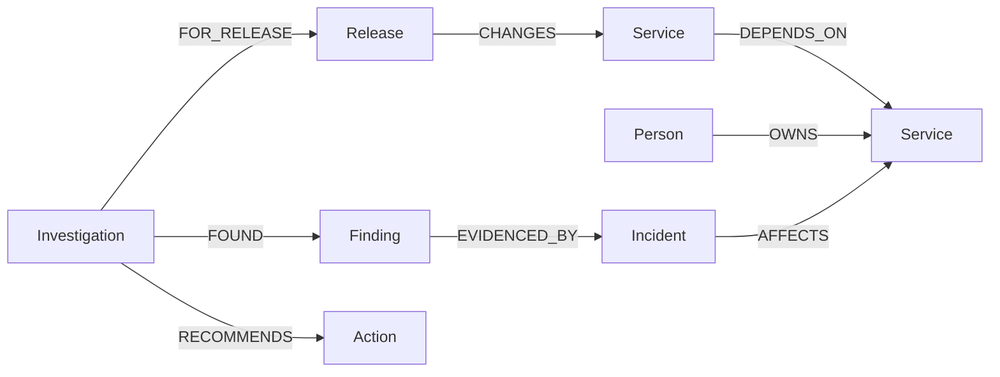

# ReleaseRadar

**A FalkorDB-backed release investigation agent for Graph Hacks 2026.**

ReleaseRadar answers “Can we ship Checkout v2?” by traversing the service dependency graph, finding open incidents on those paths, identifying owners, creating an action checklist, and storing a traceable decision. Resolve an incident and run the agent again to watch the verdict change. All product data is synthetic.

**Track:** Agents That Act on Connected Data. The project also demonstrates persistent agent memory, but the intended submission track is the first track.

## Run locally

Requirements: Docker Desktop with Compose. No API key is required.

1. Clone this repository.
2. Run `docker compose up --build` in the repository root.
3. Open [ReleaseRadar](http://localhost:4173). The [FalkorDB Browser](http://localhost:3000) is also available.
4. Click **Investigate release**. Mark a recommended action done to see its state persist. Resolve INC-1042 and INC-1048 from the incident list, then click **Investigate release** again.
5. Open **Agent memory** to compare the stored HOLD and READY decisions.

The app waits for FalkorDB and seeds the fictional graph on startup. Seeding uses `MERGE` and `ON CREATE SET`, so restarting does not reset incident status or erase investigations. The graph and agent memory persist in the Docker volume. To start a fresh demo, stop the stack and remove its volume with `docker compose down -v` (this deletes local demo graph data).

For development without containerizing the app, run `docker compose up falkordb`, then `npm install` and `npm run dev`. Copy `.env.example` values into your shell if needed. Node.js 20+ is required. Run `npm test` for the decision tests.

If FalkorDB is unavailable, the app cannot load the release, investigate, recall history, or display the graph. There is no ordinary database or fallback decision path.

## What the agent does

The agent runs a focused tool sequence:

1. `getRelease` finds the changed service.
2. `getImpactPaths` traverses `DEPENDS_ON` relationships up to four hops.
3. `getOpenIncidentPaths` finds open incidents and owners on those paths.
4. `getLatestInvestigation` recalls its previous verdict; `getServiceOwner` identifies the rollout owner.
5. It applies a transparent policy: any high severity incident means **HOLD**; only medium or low incidents mean **REVIEW**; none means **READY**.
6. `saveInvestigation` creates an `Investigation` node with `Finding` and `Action` nodes. Each finding links to the source `Incident`.

The agent is deterministic. This keeps decisions reproducible and reviewable; there is no LLM API or generated rationale in the decision path. The “action” is creation of a concrete owner checklist inside the graph. Checklist items can be marked done in the UI; their status is written back to FalkorDB and survives refreshes. The agent does not trigger an actual production deployment.

## Graph data model



Node labels and key properties:

| Label | Key properties | Purpose |
| --- | --- | --- |
| `Release` | `id`, `name`, `version` | Candidate being assessed |
| `Service` | `id`, `name`, `tier` | Deployed components |
| `Person` | `id`, `name`, `role` | Responsible owner |
| `Incident` | `id`, `severity`, `status` | Live release risk |
| `Investigation` | `id`, `verdict`, `createdAt` | Persistent decision snapshot |
| `Finding` | `id`, `path`, `severity` | Evidence recorded at decision time |
| `Action` | `id`, `text`, `owner`, `status` | Agent-created checklist item |

The synthetic topology has Checkout Web → Checkout API → Payments API → Fraud Engine and Ledger DB, alongside Feature Flags and Notification Worker. Initially, open incidents on Payments API and Fraud Engine force a HOLD. Their owners and exact graph paths are displayed in the interface.

## Essential Cypher

The runnable queries and parameters live in [`src/graph.js`](src/graph.js). These are the queries that make the release decision possible:

Find all dependency paths from the changed service:

```cypher
MATCH p=(root:Service {id: $serviceId})-[:DEPENDS_ON*1..4]->(dependency:Service)
RETURN dependency.id AS id, dependency.name AS name,
       dependency.tier AS tier, p AS path
ORDER BY dependency.name
```

Find open incidents and owners along those paths:

```cypher
MATCH p=(root:Service {id: $serviceId})-[:DEPENDS_ON*0..4]->(affected:Service)
MATCH (i:Incident)-[:AFFECTS]->(affected)
WHERE i.status = 'open'
OPTIONAL MATCH (owner:Person)-[:OWNS]->(affected)
RETURN i.id AS id, i.title AS title, i.severity AS severity,
       affected.name AS serviceName, owner.name AS ownerName, p AS path
```

Recall the last investigation:

```cypher
MATCH (v:Investigation)-[:FOR_RELEASE]->(r:Release {id: $releaseId})
RETURN v.id AS id, v.verdict AS verdict,
       v.blockerCount AS blockerCount, v.createdAt AS createdAt
ORDER BY v.createdAt DESC LIMIT 1
```

Findings are linked to incidents through `EVIDENCED_BY`; the historical path is also saved as text so a later incident resolution does not rewrite the evidence that drove the earlier decision. The current verdict is always recomputed from live incident status.

## Architecture

```
Browser UI → Node HTTP API → release agent → FalkorDB queries
                               ↘ stored investigation, findings, actions
```

The browser uses a static HTML/CSS/JavaScript interface. The server uses Node's built-in HTTP module and the official `falkordb` Node client. It connects to one graph named `release_radar`. No user data is loaded. For a public deployment, place this local demo behind access control before exposing the incident mutation endpoints.

## Demo video plan

A submission still needs a recorded demo video and a public repository URL. A 90-second recording can follow this sequence:

1. Show the graph explorer and trace Checkout Web → Checkout API → Payments API.
2. Run the agent. Show the HOLD verdict, INC-1042 and INC-1048 evidence paths, owner checklist, and tool trace.
3. Show the saved investigation in Agent memory.
4. Resolve both incidents; run the agent again.
5. Show READY, then open Agent memory to compare both stored snapshots.
6. Briefly open FalkorDB Browser and run one essential Cypher query above.

## Hackathon disclosure and data

This project was developed with AI coding assistance (OpenAI Codex). Team members should review, run, and explain the code and graph queries before submission. The dataset in `src/data.js` is wholly fictional and created for this demo. It contains no private, login-protected, personal, or paywalled records.

The product implementation was created for the October 15–18, 2026 Graph Hacks window. Team members should add the final repository link, demo video URL, and their own verified contribution notes to the submission.

## Official references

- [FalkorDB Node client](https://github.com/FalkorDB/falkordb-ts)
- [FalkorDB Docker guide](https://falkordb.github.io/docs-staging/operations/docker/)
- [FalkorDB Cypher documentation](https://docs.falkordb.com/cypher/)
